# Tafel Admin – Benutzerhandbuch

Dieses Handbuch beschreibt alle Funktionen der Tafel-Admin-Anwendung aus Sicht der Anwenderinnen und Anwender. Es richtet sich an Mitarbeiterinnen und Mitarbeiter sowie ehrenamtliche Helfer, die mit dem System täglich arbeiten.

## Inhalt

| Kapitel | Beschreibung |
|---|---|
| [Anmeldung & Übersicht](anmeldung.md) | Login, Dashboard, Ausgabetag starten/beenden, Kunden-Annahme, Scanner, Ticket-Monitor |
| [Kunden](kunden.md) | Kunden suchen, Anspruch-Schnellcheck, anlegen, bearbeiten, Duplikate, Über-Limit-Kunden, gesperrte Kunden, Neu & Verlängert, Kunden zusammenführen, Dokumente |
| [Logistik](logistik.md) | Routen-Navi auf der Route, Retourkisten-Übersicht, Warenerfassung pro Route |
| [Benutzer](benutzer.md) | Benutzerverwaltung und Berechtigungen, Anmelde-Versuche |
| [Einstellungen](einstellungen.md) | E-Mail-Empfänger, Notschlafstellen, Grenzwerte, Warenkategorien, Fahrzeuge, Länder, Mitarbeiter, anstehende Löschungen, Ankündigungen |
| [Zugriffsprotokoll](zugriffsprotokoll.md) | Wer hat wann was geändert oder auf sensible Daten zugegriffen, und wie war der Wert davor |
| [Datenauskunft](datenauskunft.md) | Kunden, Benutzerkonten und Mitarbeiter durchsuchen, DSGVO-Datenexport und -Löschung |
| [Statistiken](statistiken.md) | Allgemeine Statistik, Auswertung Kinder |

## Anmeldung

Der Login erfolgt über Benutzername und Passwort. Die Schaltfläche "Anmelden" ist dabei immer aktiv – eine Prüfung auf ausgefüllte Felder erfolgt erst beim Klick, damit vom Browser automatisch ausgefüllte Felder nicht zu einer scheinbar funktionslosen Schaltfläche führen. Fehlt ein Feld, wird das direkt am Feld angezeigt. Ist beim Tippen des Passworts die Feststelltaste aktiv, erscheint darunter ein Hinweis darauf, da das auf gemeinsam genutzten Geräten und externen Tastaturen eine häufige, leicht zu übersehende Ursache für ein falsches Passwort ist. Nach der Anmeldung gelangt man automatisch zur Übersicht (Dashboard).

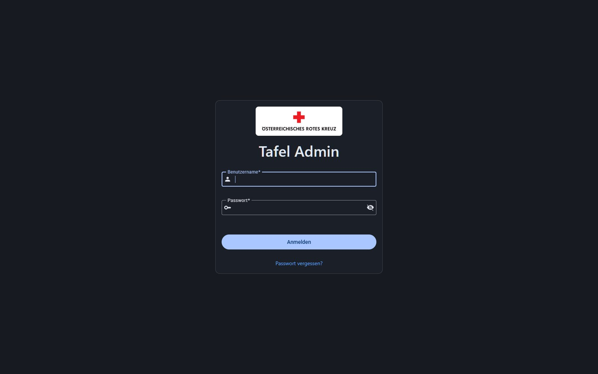

Auf Test- und Entwicklungsumgebungen wird oberhalb der Anmeldemaske zusätzlich ein durchgehendes, farblich hervorgehobenes Banner mit der Umgebungskennzeichnung (z. B. "DEV" oder "TEST") angezeigt, damit diese optisch klar von der Produktivumgebung unterscheidbar sind – gerade an baugleichen Geräten eine wichtige Absicherung gegen Verwechslungen. Auf der Produktivumgebung bleibt dieses Banner wie oben abgebildet ausgeblendet.

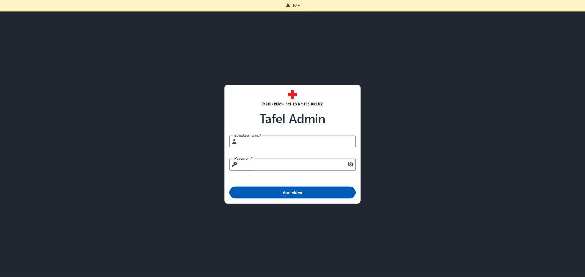

Dieselbe Umgebungskennzeichnung bleibt nach der Anmeldung als schmales Banner oben in der Kopfzeile der Anwendung sichtbar, damit auch eine bereits geöffnete Sitzung auf einer Test- oder Entwicklungsumgebung nicht mit der Produktivumgebung verwechselt werden kann.

Das Benutzer-Icon oben rechts (es zeigt die Anfangsbuchstaben von Vor- und Nachname) öffnet das Benutzermenü. Es ist in drei Gruppen gegliedert:

- **Konto**: **Mein Konto** öffnen, die Seite für alles, was das eigene Benutzerkonto betrifft: die eigenen Daten, Passwort, Zwei-Faktor-Authentifizierung, Sitzungen, Benachrichtigungen, Design und Datenschutz.
- **Hilfe**: dieses Benutzerhandbuch (immer die aktuellste Version, als PDF-Download) öffnen.
- **Abmelden**: die Sitzung auf diesem Gerät beenden (angemeldet auf anderen Geräten bleibt man, siehe **Sitzungen** unten); die Gruppe steht bewusst für sich allein, damit man sie nicht versehentlich trifft.

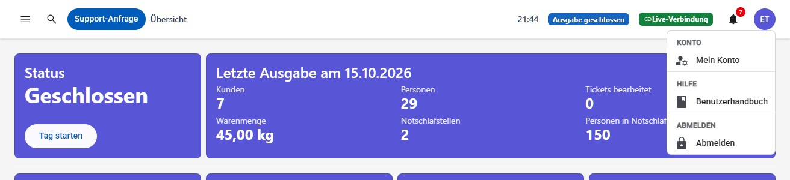

Solange **Mein Konto** geöffnet ist, zeigt die Seitenleiste statt des Hauptmenüs die Themen des Kontos, in drei Gruppen: **Profil** (**Meine Daten**, **Datenschutz**), **Sicherheit** (**Passwort**, **Zwei-Faktor-Authentifizierung**, **Sitzungen**) und **Einstellungen** (**Benachrichtigungen**, **Design**). Ganz oben führt **Zurück zur Anwendung** wieder zur Übersicht und zum Hauptmenü; auf schmalen Bildschirmen stehen die Themen wie das Hauptmenü in der ausklappbaren Seitenleiste. Jedes Thema hat eine eigene Adresse: Man kann sie als Lesezeichen speichern, und die Zurück-Taste des Browsers führt zum zuvor angesehenen Thema. Die Themen stehen jedem angemeldeten Benutzer offen, unabhängig von den Berechtigungen; über die Schnellsuche (Strg+K) lässt sich jedes Thema auch direkt aufrufen.

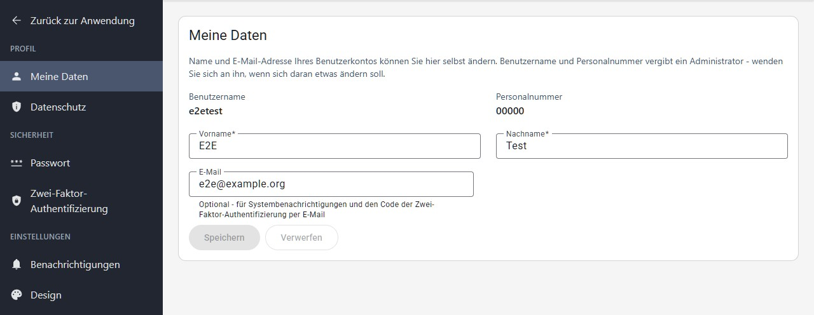

**Meine Daten** zeigt das eigene Benutzerkonto. **Benutzername** und **Personalnummer** stehen dort nur zur Ansicht – sie werden von einem Administrator vergeben (siehe [Benutzer anlegen / bearbeiten](benutzer.md#benutzer-anlegen--bearbeiten)). **Vorname**, **Nachname** und **E-Mail** ändert man selbst und bestätigt mit **Speichern**; solange nichts geändert wurde, ist die Schaltfläche ausgegraut, und **Verwerfen** stellt die gespeicherten Werte wieder her. Die E-Mail-Adresse ist optional; an sie gehen Systembenachrichtigungen und der Code der Zwei-Faktor-Authentifizierung per E-Mail. Verlangt die Anwendung eine Zwei-Faktor-Authentifizierung (siehe unten), ist die Adresse dagegen für jedes Benutzerkonto Pflicht - das Feld leeren und Speichern lehnt die Anwendung dann mit einer Fehlermeldung ab, unabhängig davon, welche Methode eingerichtet ist. Ist der **Code per E-Mail** eingerichtet, ist die Adresse außerdem der Empfänger Ihrer Anmelde-Codes: Zum Ändern verlangt die Seite dann zusätzlich einen aktuellen **Code** – aus der Authenticator-App oder per E-Mail (**Code per E-Mail senden** schickt ihn an die bisherige Adresse). Ein unbeaufsichtigt angemeldeter Browser kann die Adresse so nicht auf eine fremde umleiten. Die bisherige Adresse erhält außerdem eine Mitteilung über die Änderung. Jede Änderung wird wie bei jeder Benutzeränderung im [Zugriffsprotokoll](zugriffsprotokoll.md) festgehalten.

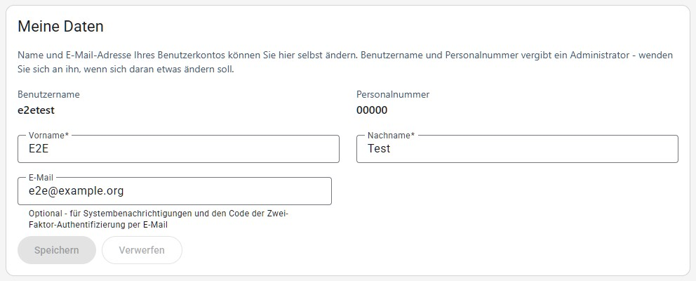

Wird eine bereits hinterlegte Adresse durch eine andere ersetzt, gilt die neue erst, **nachdem sie über die bisherige Adresse bestätigt wurde** - schließlich gehen an die Adresse Bestätigungscodes und die Links von [Passwort vergessen?](#passwort-vergessen), und ein unbeaufsichtigt angemeldeter Browser soll sie nicht umleiten können. Nach dem Speichern bleibt im Feld zunächst die bisherige Adresse stehen; ein Hinweis nennt die neue Adresse, die auf ihre Bestätigung wartet, und an die bisherige Adresse geht eine E-Mail mit dem Link **Neue E-Mail-Adresse bestätigen**. Der Link ist eine Stunde gültig und funktioniert auch auf einem anderen Gerät, ohne angemeldet zu sein; er öffnet eine Seite, auf der man die Änderung mit **Bestätigen** übernimmt - erst dieser Klick ändert die Adresse, und an die bisherige Adresse geht danach noch ein Sicherheitshinweis. Wer die Änderung nicht selbst veranlasst hat, bestätigt nicht (und ändert am besten sein Passwort). Ein weiteres Speichern einer anderen Adresse ersetzt die wartende Anfrage, ein abgelaufener, bereits verwendeter oder durch eine spätere Änderung überholter Link zeigt "Dieser Link ist ungültig oder abgelaufen.". Unmittelbar übernommen werden dagegen die erste Adresse eines Kontos (es gibt noch keine bisherige, über die man bestätigen könnte) und das Entfernen der Adresse - ebenso jede Änderung, solange auf der Anlage kein E-Mail-Versand eingerichtet ist. Ändert ein Administrator die Adresse in der Benutzerverwaltung, gilt sie sofort.

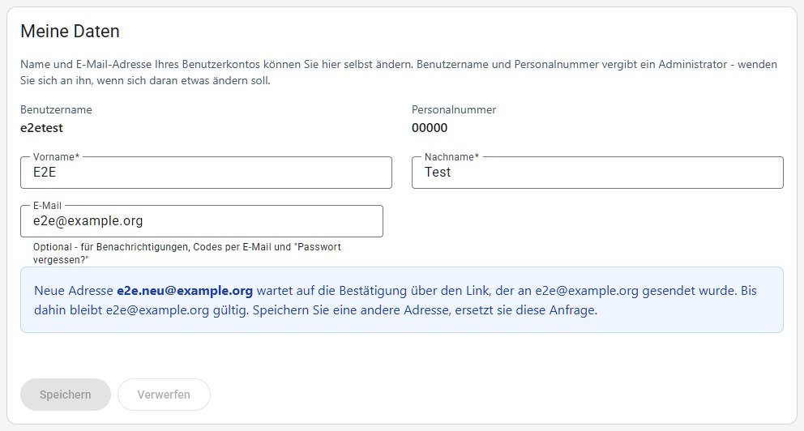

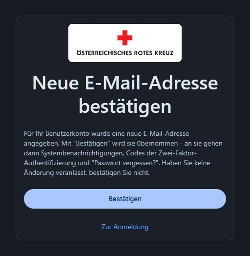

Unter **Design** wählt man, ob die Anwendung hell, dunkel oder passend zur Einstellung des Geräts (**System**, Standard) dargestellt wird. Die Auswahl gilt sofort und wird zum eigenen Benutzerkonto gespeichert: Nach der Anmeldung auf einem anderen Gerät erscheint die Anwendung wieder im selben Design. Bei **System** folgt die Anwendung auch einem späteren Wechsel der Geräteeinstellung (z. B. abends automatisch auf dunkel), ohne dass sie neu geladen werden muss.

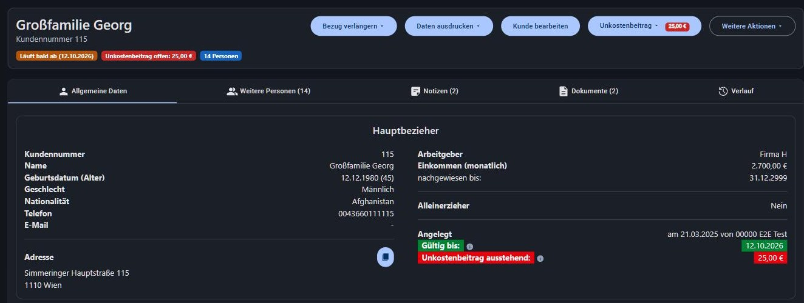

Unter **Passwort** ändert man das eigene Passwort:

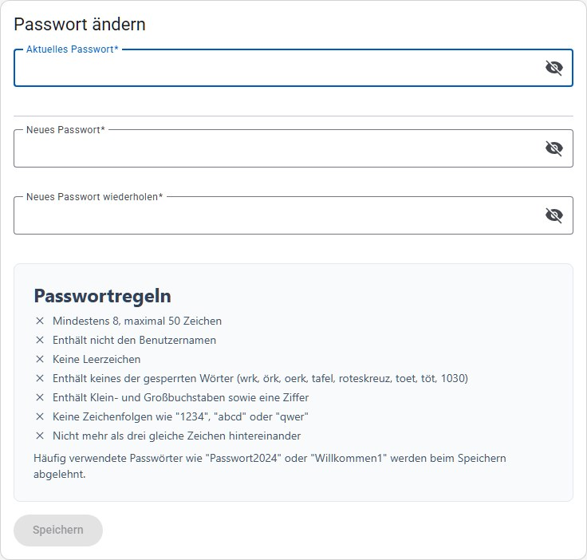

Nach dem Speichern bleibt man mit dem neuen Passwort angemeldet – ein neuerlicher Login ist nicht nötig. Auf allen anderen Geräten ist man dagegen abgemeldet: Wer das alte Passwort kannte, kommt auch über eine dort noch offene Anmeldung nicht mehr hinein. Die Anwendung bestätigt die Änderung mit einem kurzen Hinweis und leert die Felder wieder, damit die Passwörter nicht auf dem Bildschirm stehen bleiben. Das aktuelle Passwort wird dabei abgefragt; ein falsches zählt wie bei der Anmeldung als Fehlversuch und führt nach mehreren Versuchen zu einer vorübergehenden Sperre. Das eigene Passwort lässt sich nur hier ändern, nicht in der Benutzerverwaltung (siehe [Benutzer](benutzer.md#benutzer-anlegen--bearbeiten)).

Unter **Zwei-Faktor-Authentifizierung** schützt man die eigene Anmeldung zusätzlich zum Passwort. Dafür gibt es drei Methoden – **Authenticator-App**, **Code per E-Mail** und **Passkey / Sicherheitsschlüssel** –, die man einzeln oder nebeneinander einrichten kann; bei der Anmeldung genügt eine davon.

Ganz oben fasst ein Kasten zusammen, was das Konto gerade schützt: **Ihr Konto ist geschützt – 2 von 3 Methoden aktiv** (grün) oder, solange keine Methode eingerichtet ist, **Ihr Konto ist nur durch das Passwort geschützt** (gelb). Er warnt auch, wenn die Einrichtung leicht verloren gehen kann: wenn nur der Code per E-Mail eingerichtet ist (er ist nur so sicher wie das E-Mail-Postfach), wenn nur die Authenticator-App eingerichtet ist, oder wenn ein einzelner Passkey die einzige Methode ist – in diesen Fällen wird eine zweite Methode bzw. ein zweiter Passkey empfohlen. Mehrere Passkeys allein gelten nicht als unsicher, da jeder für sich zur Anmeldung reicht.

Darunter steht jede Methode in einer eigenen Zeile mit ihrem Status – **Nicht aktiv**, **Wird eingerichtet** oder **Aktiv** (bei Passkeys die Anzahl, z. B. **2 eingerichtet**). Ein Klick auf die Zeile klappt sie auf: Dort richtet man die Methode ein oder entfernt sie wieder. Die **Authenticator-App** trägt die Kennzeichnung **Empfohlen**: Ein Code aus einer App gilt als sicherer als einer per E-Mail, da er auch ohne Internetverbindung funktioniert und nicht vom Schutz des E-Mail-Postfachs abhängt.

- **Authenticator-App** (z. B. auf dem Smartphone): Zum Einrichten wählt man **Einrichten**, es erscheint ein QR-Code, den man mit der App scannt (wer noch keine App hat, findet über die Links **Google Play** und **App Store** darüber den kostenlosen Google Authenticator - jede App für zeitbasierte Codes funktioniert); kann die App nicht scannen, gibt man stattdessen den darunter angezeigten Schlüssel von Hand ein. Danach gibt man den 6-stelligen Code aus der App ein und wählt **Aktivieren** – erst mit einem gültigen Code ist die Methode eingeschaltet, womit auch geprüft ist, dass die App richtig eingerichtet wurde. Mit **Abbrechen** verwirft man eine begonnene Einrichtung.
- **Code per E-Mail**: Die Zeile nennt die E-Mail-Adresse des Benutzerkontos, an die der Code geht, teilweise verdeckt (z. B. "an m\*\*\*@example.at"); aufgeklappt steht sie vollständig da (ändern lässt sie sich unter **Meine Daten**). Zum Einrichten wählt man **Einrichten**; ein 6-stelliger Code wird an diese Adresse gesendet (mit **Code erneut senden** lässt er sich nach kurzer Wartezeit neu anfordern). Man gibt ihn ein und wählt **Aktivieren**. Der Code gilt nur kurz und nur einmal. Ist für das Benutzerkonto keine E-Mail-Adresse hinterlegt, verweist die Zeile auf **Meine Daten**, bis eine eingetragen ist. Steht auf dem System kein E-Mail-Versand zur Verfügung, zeigt die Zeile **Nicht verfügbar**, und diese Methode lässt sich nicht einrichten.
- **Passkey / Sicherheitsschlüssel**: Damit bestätigt man die Anmeldung per Fingerabdruck, Gesichtserkennung, Geräte-PIN oder Sicherheitsschlüssel (z. B. einem YubiKey), statt einen Code einzutippen. Ein Passkey im Gerät gehört zu dem Gerät (oder dem Passwort-Manager), auf dem er eingerichtet wurde – er eignet sich daher für das eigene Notebook oder Smartphone, nicht für einen gemeinsam genutzten PC. Ein **Sicherheitsschlüssel** ist dagegen ein kleiner Schlüssel für den Schlüsselbund, den man an jedem PC per USB ansteckt oder an Smartphone bzw. Tablet per NFC auflegt – er eignet sich gerade für gemeinsam genutzte PCs und braucht weder Smartphone noch Internetverbindung. Zum Einrichten gibt man dem Passkey einen **Namen** (z. B. das Gerät oder "YubiKey") und wählt **Passkey hinzufügen** für einen Passkey im Gerät oder **Sicherheitsschlüssel hinzufügen** für einen eigenen Schlüssel; der Browser fragt dann nach dem Fingerabdruck, der PIN oder dem Sicherheitsschlüssel (den Schlüssel steckt man dann an bzw. legt ihn auf und berührt ihn; wurde am Schlüssel eine PIN festgelegt, fragt der Browser auch nach ihr). Unter Windows erscheint dafür ein eigenes Fenster "Windows-Sicherheit", in dem man gegebenenfalls **Sicherheitsschlüssel** wählt. Die Liste zeigt jeden eingerichteten Passkey mit seinem Namen, der Art (**Gerät** für einen im Gerät eingebauten Passkey, **Sicherheitsschlüssel** für einen eigenen Schlüssel zum Anstecken oder Auflegen), dem Datum der Einrichtung und wann er zuletzt verwendet wurde; es lassen sich mehrere einrichten, etwa einer je Gerät. **Ist ein Passkey die einzige Methode und das Gerät nicht zur Hand, ist keine Anmeldung möglich**, bis ein Administrator die Zwei-Faktor-Authentifizierung zurücksetzt (siehe [Benutzer](benutzer.md)) – eine weitere Methode, ein zweiter Passkey auf einem anderen Gerät oder ein **Ersatzschlüssel** (ein zweiter Sicherheitsschlüssel, der sicher aufbewahrt wird) beugt dem vor. Wer die Authenticator-App lieber auf einem YubiKey hat, kann die Codes auch mit der App "Yubico Authenticator" erzeugen und den Schlüssel so als **Authenticator-App** einrichten. Unterstützt der Browser keine Passkeys, steht das in der Zeile, und es lässt sich dort keiner hinzufügen.

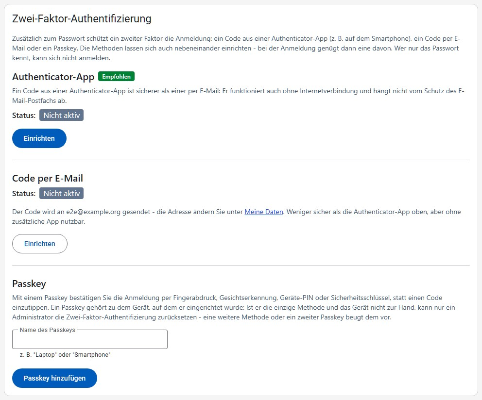

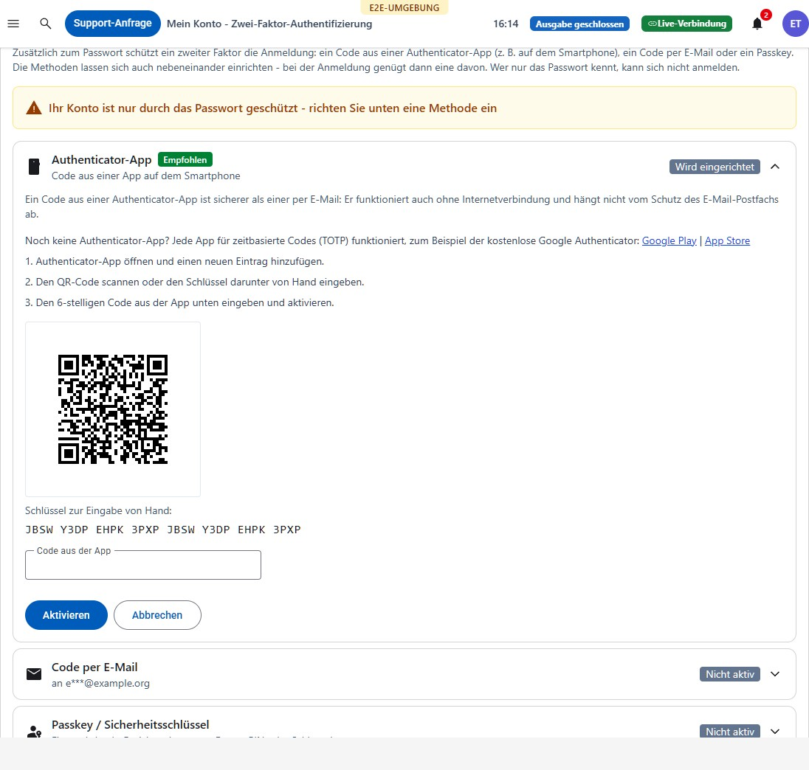

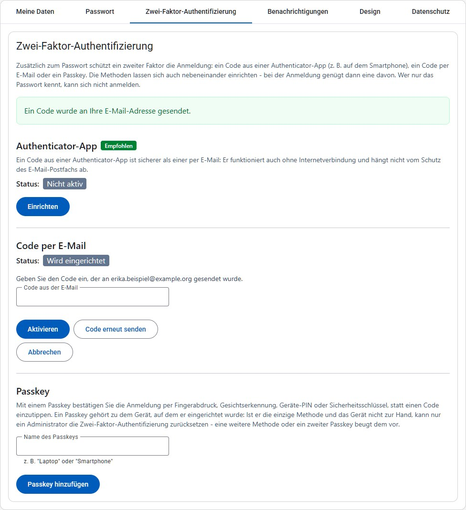

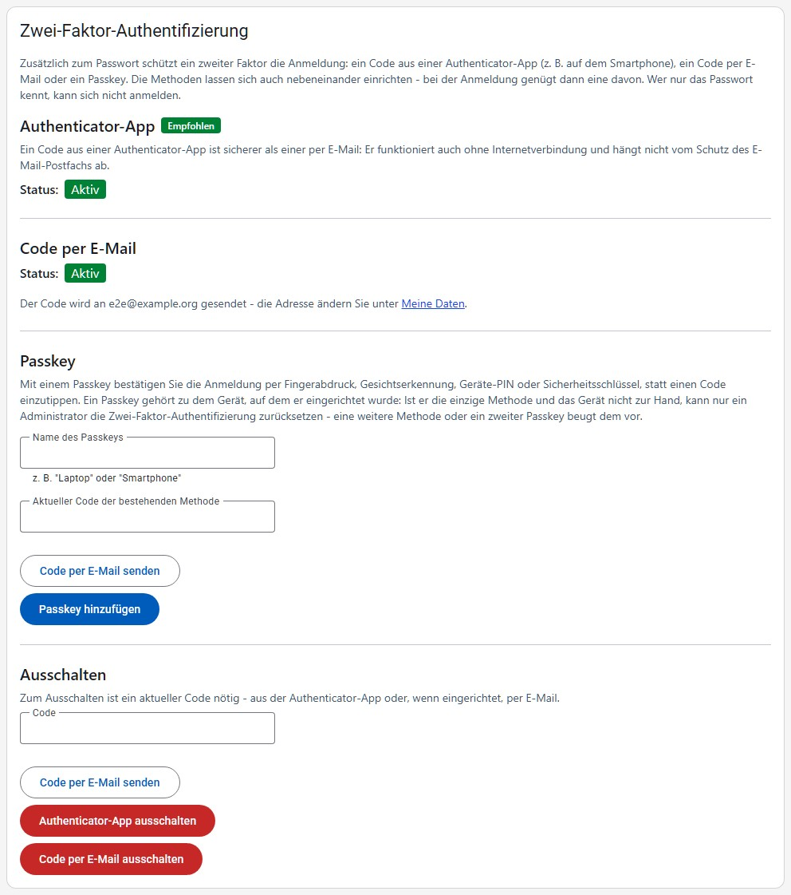

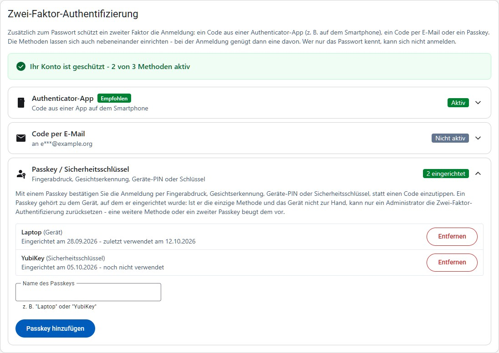

Ab dann verlangt jede Anmeldung nach dem Passwort einen Code oder den Passkey (siehe [Anmeldung mit Bestätigungscode](#anmeldung-mit-bestätigungscode)); auch bereits geöffnete Sitzungen auf anderen Geräten müssen das nachträglich bestätigen. Entfernt wird eine Methode in ihrer eigenen Zeile – **Authenticator-App entfernen**, **Code per E-Mail entfernen** bzw. **Entfernen** neben einem Passkey.

Jede Änderung, solange bereits eine Methode eingerichtet ist – eine weitere Methode oder einen Passkey hinzufügen, eine Methode oder einen Passkey entfernen –, muss man in einem eigenen Fenster mit einer bestehenden Methode bestätigen: Man gibt dort einen aktuellen Code aus der App oder per E-Mail ein (diesen fordert man im Fenster mit **Code per E-Mail senden** an) und bestätigt. Ist der Code falsch, sagt das Fenster es und bleibt für einen neuen Versuch offen. Beim Hinzufügen der Authenticator-App oder des Codes per E-Mail schließt sich das Fenster stattdessen, und die Meldung steht auf der Seite: Dort kann auch der Code der neuen Methode falsch gewesen sein (etwa ein inzwischen abgelaufener Code aus der App), deshalb gibt man beide Codes neu ein. Wer nur Passkeys eingerichtet hat, bestätigt stattdessen mit einem davon – der Browser fragt danach. Das schützt davor, dass jemand an einem unbeaufsichtigt angemeldeten Browser die Zwei-Faktor-Authentifizierung ausschaltet oder eine eigene Authenticator-App, Adresse oder einen eigenen Passkey danebenstellt. Nur die allererste Methode lässt sich ohne diese Bestätigung einrichten.

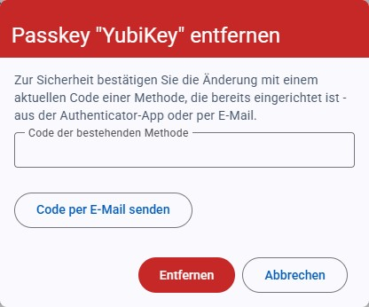

Über jede Änderung – eine eingerichtete oder entfernte Methode, eine geänderte E-Mail-Adresse oder das Zurücksetzen durch einen Administrator – informiert eine E-Mail an die Adresse des Benutzerkontos (bei einer geänderten Adresse an die bisherige), sofern der E-Mail-Versand eingerichtet ist und eine Adresse hinterlegt war. Das gilt auch für einen hinzugefügten oder entfernten Passkey. Der Schlüssel der App verlässt den Server nicht: Er steht in keiner Antwort und in keinem Export, in der Datenauskunft steht nur, ob die Zwei-Faktor-Authentifizierung aktiv ist, mit welchen Methoden, und wie die eingerichteten Passkeys heißen.

Ist die Zwei-Faktor-Authentifizierung für die gesamte Anwendung vorgeschrieben (das legt der Betreiber der Anwendung fest, nicht ein einzelner Benutzer), muss mindestens eine Methode eingerichtet sein - **und unabhängig davon eine E-Mail-Adresse hinterlegt sein**, auch wenn die gewählte Methode die Authenticator-App ist: Der Speichern-Button auf **Meine Daten** (und die entsprechenden Felder in der Benutzerverwaltung) verweigern dann eine leere Adresse. Wer noch etwas davon nicht hat, richtet es direkt im Anmelde-Vorgang ein: Nach Benutzername und Passwort erscheint statt der Übersicht eine eigene Einrichtungsseite. Die E-Mail-Adresse ist dort ein eigener, von der Methode unabhängiger Schritt, der vor der Methodenauswahl steht - ist noch keine Methode eingerichtet, sieht man beides zugleich; ist bereits eine Methode aktiv (z. B. die App) und nur die Adresse fehlt, zeigt die Seite ausschließlich das Adressfeld. Das Speichern der Adresse allein startet noch keinen Code per E-Mail - das bleibt ein eigener, bewusster Klick auf **Einrichten** unter "Code per E-Mail", falls diese Methode gewünscht ist. Auch eine bereits geöffnete Sitzung wird auf diese Seite geleitet, sobald der Betreiber die Vorschrift einschaltet, und kann bis zur Einrichtung nichts anderes in der Anwendung tun, auch keine andere Adresse direkt aufrufen; über **Abbrechen und abmelden** lässt sich die Anmeldung stattdessen abbrechen. Sobald nichts mehr fehlt, geht es normal weiter (bzw. mit einer noch fälligen Passwortänderung), und die Seite **Zwei-Faktor-Authentifizierung** in **Mein Konto** weist von da an im Kasten oben darauf hin, dass eine Methode eingerichtet bleiben muss; die letzte lässt sich nicht mehr entfernen.

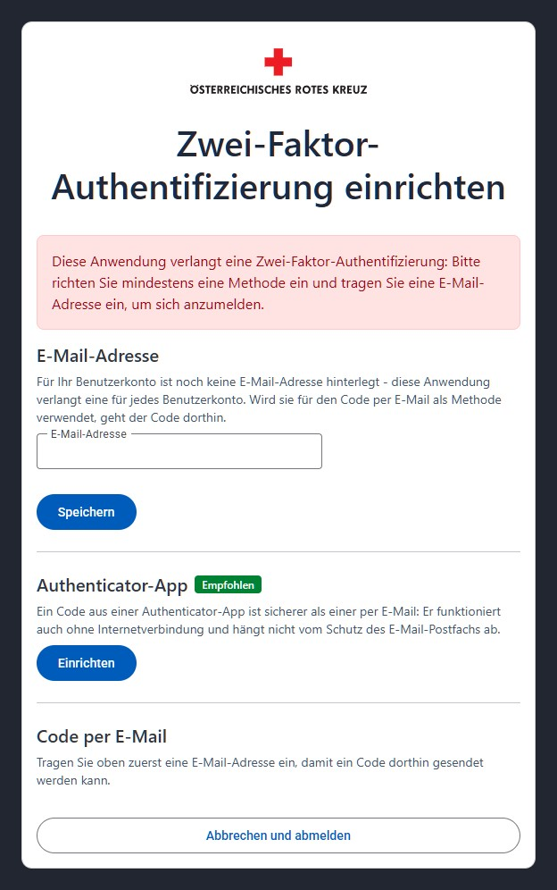

**Sitzungen** zeigt, auf welchen Geräten man gerade angemeldet ist: für jede Anmeldung Browser und Betriebssystem (z. B. "Firefox unter Windows", mit einem Symbol für Computer oder Handy), wann man sich angemeldet hat und wann sie zuletzt benutzt wurde. Die Anmeldung, an der man gerade sitzt, ist mit **(diese Sitzung)** gekennzeichnet. Eine andere Anmeldung, die man nicht mehr braucht oder nicht kennt – etwa am gemeinsam genutzten PC bei der Ausgabe, auf dem man vergessen hat, sich abzumelden, oder auf einem verlorenen Handy –, beendet man mit **Beenden**; **Alle anderen Sitzungen beenden** beendet alle bis auf die eigene. Das Gerät ist danach sofort abgemeldet, auch eine dort offene Seite: Sie zeigt beim nächsten Schritt die Anmeldeseite. Die eigene Sitzung beendet man wie gewohnt mit **Abmelden**. Eine Anmeldung endet außerdem von selbst zehn Stunden nach der Anmeldung, und wenn ein Administrator alle Sitzungen des Benutzerkontos beendet (siehe [Benutzer](benutzer.md#benutzerdetails)).

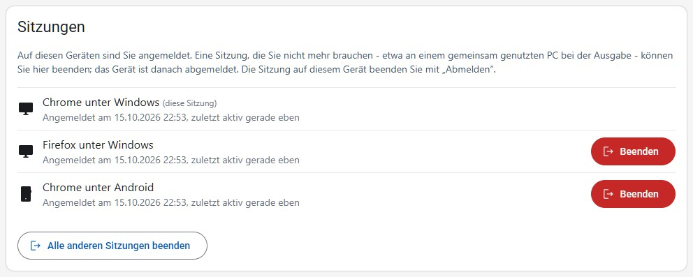

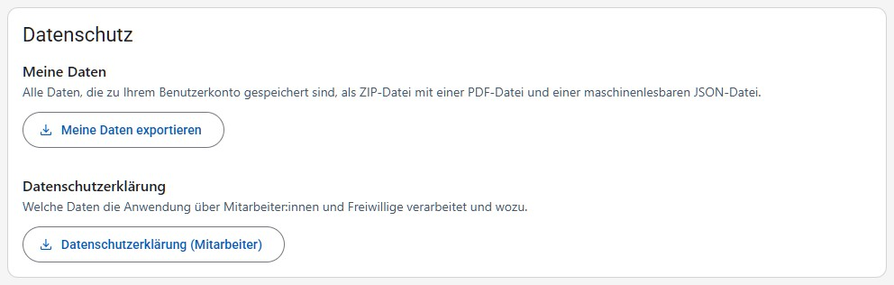

Unter **Datenschutz** lädt man über **Meine Daten exportieren** eine DSGVO-Datenauskunft (Art. 15/20) zum eigenen Benutzerkonto als ZIP-Datei herunter – mit einer PDF-Datei und einer maschinenlesbaren JSON-Datei: Benutzername, Personalnummer, Name, die E-Mail-Adresse, die zugewiesenen Berechtigungen, der Aktiv-Status sowie der letzte Login-Zeitpunkt. Das gespeicherte Passwort ist darin nie enthalten. Für eine andere Person kann dieselbe Auskunft auch von einem Benutzer mit Benutzerverwaltungs-Berechtigung über dessen Benutzerdetailseite abgerufen werden, siehe [Benutzer](benutzer.md).

Ebenfalls unter **Datenschutz** lädt man über **Datenschutzerklärung (Mitarbeiter)** eine allgemeine, personenunabhängige Datenschutzerklärung für Mitarbeiter:innen und Freiwillige als PDF herunter: welche Daten über Mitarbeiter:innen verarbeitet werden, auf welcher Grundlage, wie lange und mit welchen Rechten. Dasselbe Dokument steht auch ohne eigenes Benutzerkonto zur Verfügung, siehe [Mitarbeiter](einstellungen.md#mitarbeiter).

Unter **Benachrichtigungen** kann man Push-Benachrichtigungen für den aktuell verwendeten Browser aktivieren, z. B. um automatisch informiert zu werden, sobald eine Ausgabe gestartet oder beendet wurde. Solche Benachrichtigungen erreichen das Gerät auch dann, wenn die Anwendung gerade nicht geöffnet ist. Da die Anmeldung pro Gerät/Browser erfolgt, muss dieser Schalter auf jedem Gerät einzeln aktiviert werden, auf dem Benachrichtigungen gewünscht sind. Unterstützt der aktuelle Browser keine Push-Benachrichtigungen, wird stattdessen ein entsprechender Hinweis angezeigt.

Wurden Benachrichtigungen im Browser selbst blockiert – etwa weil die Nachfrage des Browsers einmal mit "Blockieren" beantwortet wurde –, kann die Anwendung sie nicht aktivieren. In diesem Fall wird der Schalter deaktiviert dargestellt und darüber der Grund samt Lösungsweg angezeigt: Die Blockade lässt sich nur in den Seiteneinstellungen des Browsers selbst wieder aufheben.

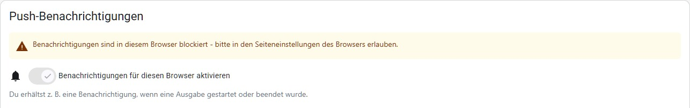

Tippt bzw. klickt man auf eine eingetroffene Benachrichtigung, öffnet sich direkt die passende Seite in der Anwendung – z. B. die Waren-Eingabe bei einer unvollständigen Warenerfassung. Ist die Anwendung bereits in einem Fenster geöffnet, wird dieses verwendet, statt ein weiteres zu öffnen.

Darunter listet **Deine Geräte** alle für den eigenen Account aktivierten Geräte, jeweils mit Browser-/Betriebssystem-Erkennung und dem Zeitpunkt der Registrierung. Ein Symbol vor dem Namen zeigt, ob es sich um ein Mobilgerät oder um einen Computer handelt, und die Registrierung wird zuerst als Zeitspanne angegeben ("Registriert vor 3 Wochen"), gefolgt vom genauen Zeitpunkt. Beides hilft dabei, ein altes, nicht mehr verwendetes Gerät in der Liste wiederzuerkennen. Über das Stift-Symbol kann jedem Gerät ein eigener, frei wählbarer Name gegeben werden (z. B. "Tafel Ausgabe 1"), um es in der Liste leichter wiederzuerkennen – dieser Name überschreibt dann die automatische Browser-/Betriebssystem-Anzeige.

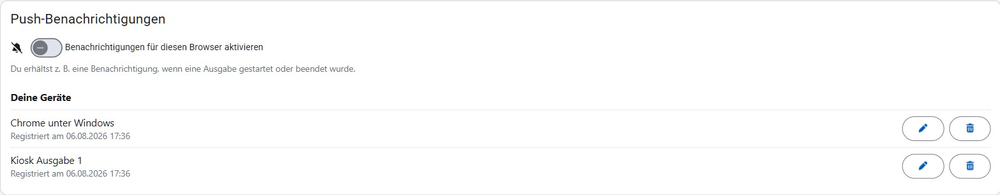

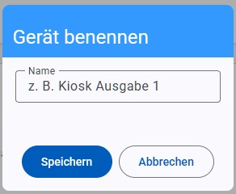

Über das Senden-Symbol (Papierflieger) kann jederzeit eine **Test-Benachrichtigung** an ein einzelnes Gerät geschickt werden. Damit lässt sich sofort überprüfen, ob auf diesem Gerät tatsächlich Benachrichtigungen ankommen, ohne auf die nächste Ausgabe warten zu müssen. Erscheint die Test-Benachrichtigung nicht, wird stattdessen der Grund gemeldet – etwa dass das Gerät beim Push-Dienst nicht mehr angemeldet ist (in diesem Fall wird es aus der Liste entfernt und muss auf dem betroffenen Gerät neu aktiviert werden) oder dass am Server keine Push-Benachrichtigungen eingerichtet sind. Das Ergebnis bleibt zusätzlich direkt beim jeweiligen Gerät stehen – während des Sendens "Test wird gesendet …", danach das Ergebnis –, sodass man es auch dann noch sieht, wenn man zwischenzeitlich am Gerät nachgesehen hat und die Einblendung längst wieder verschwunden ist. Die Test-Benachrichtigung wird unabhängig von den weiter unten beschriebenen Benachrichtigungsarten immer zugestellt.

Über das Mistkübel-Symbol kann ein Gerät entfernt werden – etwa wenn es nicht mehr verwendet wird oder verloren gegangen ist. Wird dabei das gerade selbst verwendete Gerät entfernt, wird der Schalter zum Aktivieren der Benachrichtigungen automatisch deaktiviert.

Im Bereich **Benachrichtigungsarten** darunter lässt sich feiner steuern, welche Benachrichtigungen man erhält. Der Schalter **Alle Benachrichtigungen erhalten** ist ein zentraler Hauptschalter für den eigenen Account: Ist er deaktiviert, erhält man auf keinem der eigenen Geräte mehr Benachrichtigungen, unabhängig von den einzelnen Einstellungen darunter – im Gegensatz zum Schalter weiter oben betrifft dies also nicht nur das aktuell verwendete Gerät, sondern alle. Ist der Hauptschalter aktiv, kann darunter für jede einzelne Benachrichtigungsart separat festgelegt werden, ob man sie erhalten möchte. Unter jedem Schalter steht, wann die jeweilige Benachrichtigung ausgelöst wird. Ist der Hauptschalter deaktiviert, bleibt die Liste sichtbar, ist aber nicht mehr bedienbar: Die einzelnen Einstellungen bleiben gespeichert und wirken wieder, sobald der Hauptschalter erneut aktiviert wird. Ein Hinweis über der Liste erklärt das.

Es werden nur jene Benachrichtigungsarten angezeigt, für die man auch berechtigt ist – wer z. B. keine Administrator-Berechtigung hat, sieht die Art "Benutzer gesperrt" gar nicht erst in der Liste.

Die Liste ist in vier Bereiche gegliedert: **Ablauf der Ausgabe**, **Erinnerungen**, **Technisches** und **Mitteilungen**. Bereiche, für die man keine der nötigen Berechtigungen hat, werden gar nicht erst angezeigt.

Der Bereich **Ablauf der Ausgabe** begleitet einen Ausgabetag von Anfang bis Ende – in genau der Reihenfolge, in der die Schritte tatsächlich passieren –, sodass man auch ohne geöffnete Anwendung mitbekommt, wie weit der Tag ist. Diese Arten stehen allen Benutzern zur Verfügung:

| Benachrichtigungsart | Wird ausgelöst, wenn … |
| --- | --- |
| Ausgabe gestartet | eine Ausgabe gestartet wurde |
| Anmeldung gestartet | der erste Kunde des Tages angemeldet wurde |
| Route beim letzten Stopp | eine Route im [Routen-Navi](logistik.md#routen-navi) bis auf den letzten Stopp abgehakt ist, das Fahrzeug also bald zurückkommt. Die Benachrichtigung nennt die Route und den Stopp, bei dem sie gerade steht |
| Warenerfassung abgeschlossen | für alle aktiven Routen die Waren vollständig erfasst wurden |
| Warenausgabe gestartet | das erste Ticket abgearbeitet wurde, die Warenausgabe also tatsächlich läuft |
| Alle Kunden abgearbeitet | alle angemeldeten Kunden abgearbeitet wurden |
| Ausgabe beendet | eine Ausgabe beendet wurde und die Statistiken bereitstehen |

Die Bereiche **Erinnerungen** und **Technisches** setzen eine Berechtigung voraus:

| Benachrichtigungsart | Wird ausgelöst, wenn … | Erforderliche Berechtigung |
| --- | --- | --- |
| Ausgabe noch offen | eine Ausgabe an einem früheren Tag gestartet und bis dahin nicht beendet wurde (Erinnerung jeweils in der Früh, bis die Ausgabe beendet ist) | Ausgabe-Ablauf oder Supervisor |
| Gescannte Dateien werden bald gelöscht | eine Datei im Scanner-Ordner (siehe [Kunden](kunden.md)) bald automatisch gelöscht wird, weil sie zu lange nicht importiert oder gelöscht wurde (Erinnerung jeweils in der Früh, bis die Datei importiert, gelöscht oder tatsächlich automatisch entfernt wurde) | Kunden-Dokumente |
| Sperren überprüfen | Kunden ohne Enddatum gesperrt sind und ihre Sperre seit mehr als der konfigurierten Frist (standardmäßig 6 Monate) nicht überprüft wurde (Erinnerung jeweils montags in der Früh, solange es solche Sperren gibt). Die Benachrichtigung nennt die Anzahl und öffnet die Seite [Gesperrte Kunden](kunden.md#gesperrte-kunden) | Kunden |
| E-Mail nicht versendet | eine E-Mail auch nach mehreren Versuchen nicht versendet werden konnte – etwa eine der E-Mails nach dem Ende einer Ausgabe (Tagesreport, Statistiken, Retourkisten) oder eine Support-Anfrage. Die Benachrichtigung nennt den Betreff der E-Mail | Administrator |
| Benutzer gesperrt | ein Benutzer nach zu vielen fehlgeschlagenen Anmeldeversuchen gesperrt wurde | Administrator |
| Ungewöhnlich viele Zugriffe | ein Benutzerkonto innerhalb einer Stunde mehr sensible Kundendaten abgerufen hat (Dokument-Downloads, Stammdatenblatt/Ausweis/Kundenliste) als der konfigurierte Schwellenwert erlaubt. Die Benachrichtigung nennt den Benutzernamen und die Anzahl der Abrufe | Administrator |
| Bereinigungsjob auffällig | ein Bereinigungsjob (Kunden, Benutzer, Mitarbeiter, Zugriffsprotokoll) fehlgeschlagen ist oder mehr Datensätze gelöscht hätte als konfiguriert | Administrator |
| Daten werden bald gelöscht | Benutzerkonten (außer Administrator-Konten), Kunden oder Mitarbeiter innerhalb der nächsten 30 Tage automatisch gelöscht werden, weil ihre Aufbewahrungsfrist abläuft: ein Benutzerkonto nach einem Jahr ohne Anmeldung, ein Mitarbeiter nach zwei Jahren ohne Einsatz als Fahrer:in oder Beifahrer:in, ein Kunde 7 Jahre nach Ablauf der Gültigkeit (Erinnerung jeweils in der Früh, solange es solche Datensätze gibt). Die Benachrichtigung nennt die Anzahl je Bereich und öffnet die Seite Einstellungen → Anstehende Löschungen (siehe [Einstellungen](einstellungen.md#anstehende-loeschungen)), die genau auflistet, was gelöscht wird. Eine Anmeldung der Person erhält ein Benutzerkonto, eine Verlängerung der Gültigkeit einen Kunden | Administrator |

Die letzten fünf sind technische Meldungen: sie richten sich an jene Personen, die die Anwendung selbst betreuen, und nicht an die Ausgabe-Leitung. Da die Berechtigung "Administrator" alle anderen Berechtigungen einschließt, sehen Administratoren sämtliche Benachrichtigungsarten.

Im Bereich **Mitteilungen** steht **Ankündigungen**: Sie kommt, wenn ein Administrator eine neue Ankündigung für alle Benutzer veröffentlicht (siehe [Ankündigungen](einstellungen.md#ankuendigungen)); die Ankündigung steht zusätzlich in der [Glocke](#benachrichtigungen-glocke). Diese Art erreicht alle Benutzer mit eingeschaltetem Push, solange sie sie nicht abgeschaltet haben.

Jede dieser Benachrichtigungen wird pro Ausgabe nur ein einziges Mal verschickt. Wird z. B. ein bereits abgearbeitetes Ticket noch einmal geöffnet und erneut abgeschlossen, kommt "Alle Kunden abgearbeitet" trotzdem kein zweites Mal. "Route beim letzten Stopp" gilt je Route und Tag: Jede Route meldet sich einmal, auch wenn unterwegs ein Stopp noch einmal zurückgenommen und erneut abgehakt wird.

Die "Startzeit", die auf dem Ticket-Monitor angezeigt werden kann, ist davon unabhängig: sie ist eine Ankündigung an die wartenden Kunden, während sich "Warenausgabe gestartet" nach dem tatsächlichen Beginn richtet.

Die Berechtigungen sind unter [Benutzer](benutzer.md) beschrieben.

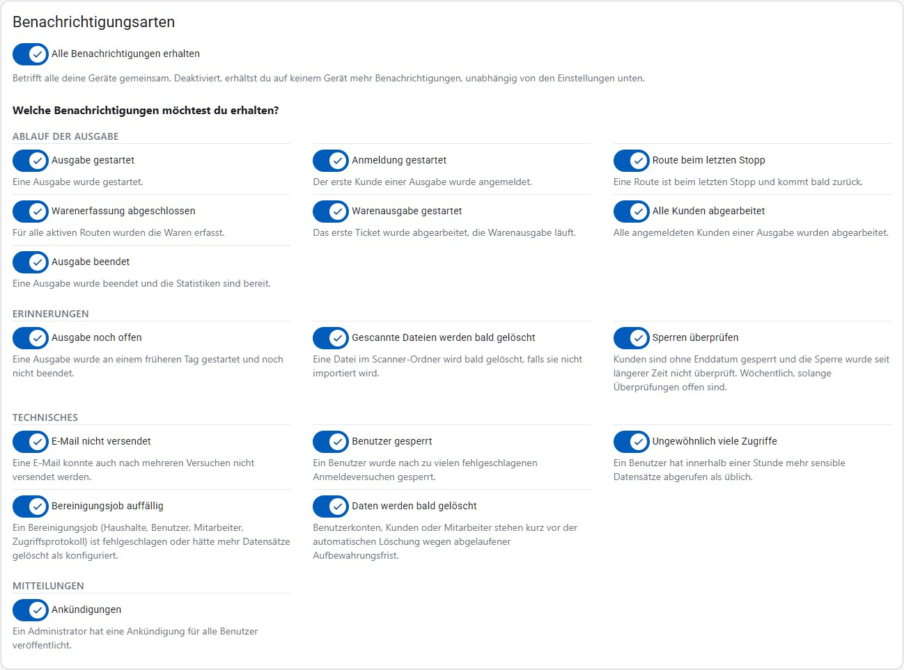

Bei deaktiviertem Hauptschalter sieht derselbe Bereich so aus:

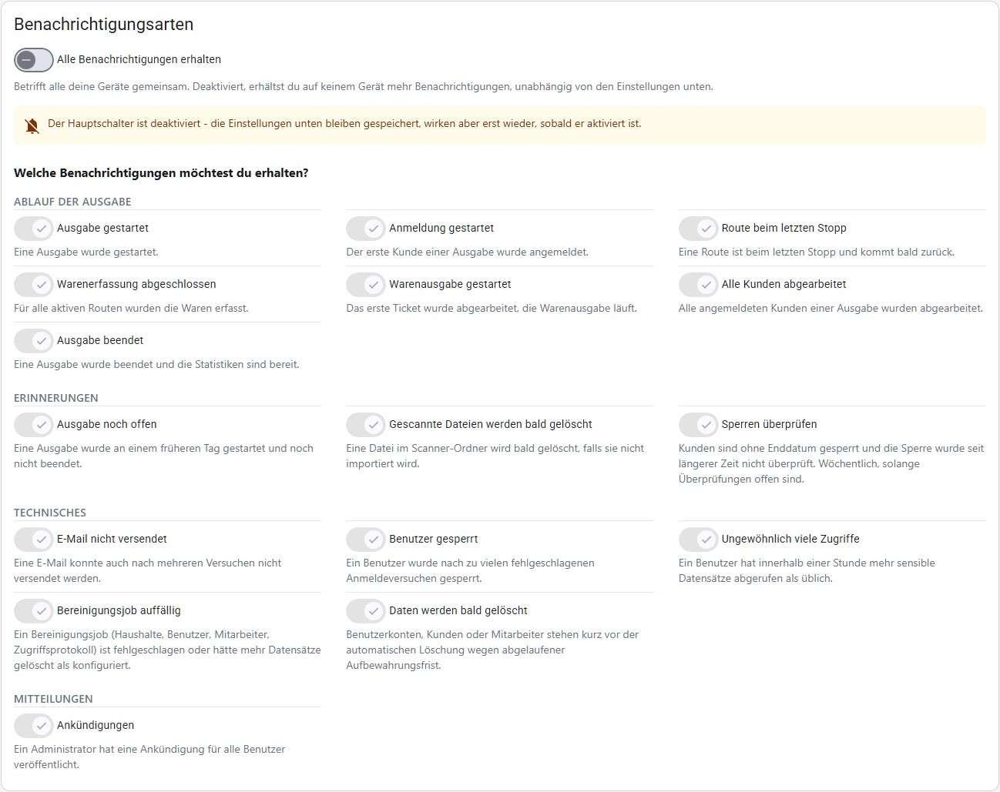

Ist beim Login eine Passwortänderung erforderlich (z. B. beim erstmaligen Login oder nach einem von der Verwaltung erzwungenen Passwortwechsel), zeigt das System stattdessen direkt nach der Anmeldung automatisch eine eigene, davon unabhängige Seite – noch bevor die eigentliche Anwendung geöffnet wird. Ein Hinweistext direkt unter dem Titel erklärt, warum diese Seite erscheint. Die Schaltfläche zum Verlassen der Seite heißt hier bewusst **Abmelden** statt "Abbrechen": Ein Klick darauf beendet tatsächlich die Sitzung, man gelangt also nicht ohne Passwortänderung in die Anwendung.

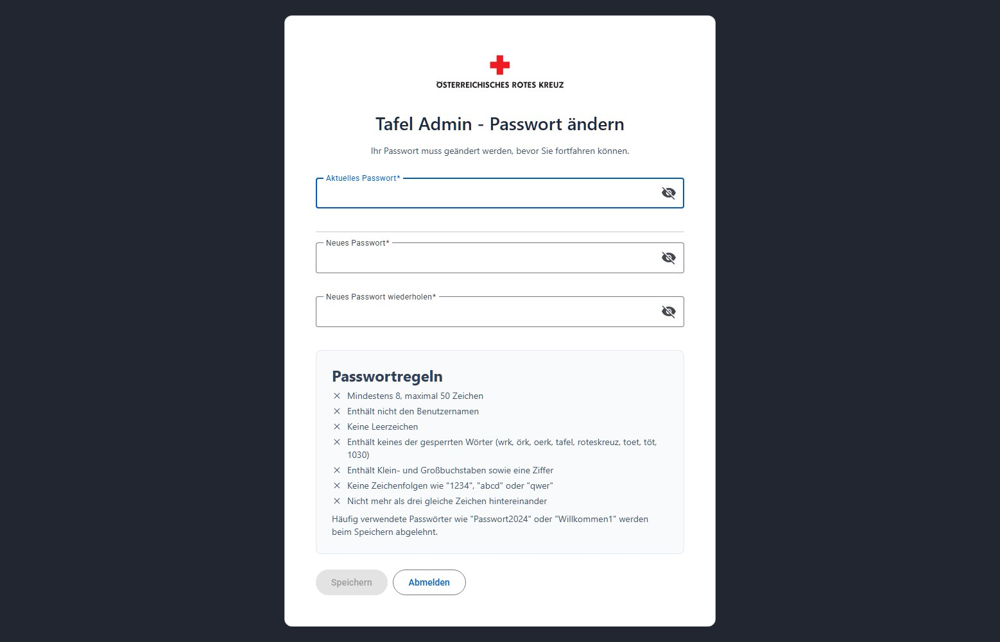

In beiden Fällen gelten dieselben Regeln: Das neue Passwort muss mindestens 8 und maximal 50 Zeichen lang sein, darf den Benutzernamen nicht enthalten, keine Leerzeichen haben, bestimmte Wörter (z. B. "wrk", "tafel", "roteskreuz") nicht enthalten und sowohl Klein- als auch Großbuchstaben sowie eine Ziffer enthalten. Außerdem darf es keine Zeichenfolgen wie "1234", "abcd" oder "qwer" (auch rückwärts) und nicht mehr als drei gleiche Zeichen hintereinander enthalten, und häufig verwendete Passwörter wie "Passwort2024" oder "Willkommen1" werden abgelehnt. Bereits gesetzte Passwörter bleiben gültig; die Regeln gelten nur beim Festlegen eines neuen Passworts. Eine Checkliste unterhalb der Eingabefelder zeigt für jede dieser Regeln direkt beim Tippen an, ob sie bereits erfüllt ist, sodass Fehler auffallen, bevor "Speichern" überhaupt versucht wird. Ein Balken unter dem Feld "Neues Passwort" zeigt zusätzlich dessen Stärke (Schwach/Mittel/Stark) an, sobald mit dem Tippen begonnen wurde – farblich passend in Rot, Orange bzw. Grün. Nach dem Speichern meldet die Seite kurz "Passwort geändert – Anmeldung läuft…", bevor automatisch zur Übersicht weitergeleitet wird.

### Anmeldung mit Bestätigungscode

Hat ein Benutzerkonto die Zwei-Faktor-Authentifizierung eingeschaltet (siehe oben), folgt auf Benutzername und Passwort die Seite **Bestätigungscode**. Dort gibt man den 6-stelligen Code ein und bestätigt mit **Bestätigen**: bei der Authenticator-App den Code aus der App (er ändert sich alle 30 Sekunden), bei einem Konto mit Code per E-Mail den Code aus der E-Mail. Hat das Konto nur diese Methode, wird der Code beim Öffnen der Seite automatisch gesendet; hat es beide, wählt man **Code per E-Mail senden**, wenn man den Code lieber per E-Mail bekommen möchte. Erst nach dem Code ist die Anmeldung abgeschlossen – bis dahin steht nichts in der Anwendung zur Verfügung, auch dann nicht, wenn man die Adresse einer Seite direkt aufruft, denn man wird zurück auf die Codeseite geleitet. Ein falscher Code wird mit "Der Code ist ungültig, oder es gab zu viele Fehlversuche - bitte später erneut versuchen!" abgelehnt. Nach mehreren Fehlversuchen wird die Codeeingabe vorübergehend gesperrt (dieselbe Grenze und Dauer wie bei einem falschen Passwort, siehe [Benutzer](benutzer.md#anmelde-versuche)), auch für den richtigen Code. Jeder Code gilt nur einmal: Ein bereits verwendeter Code wird abgelehnt, man wartet dann auf den nächsten in der App bzw. fordert per E-Mail einen neuen an. Ein per E-Mail gesendeter Code gehört außerdem zu der Anmeldung, für die er gesendet wurde: Beginnt man eine neue Anmeldung, wird ein noch offener Code der früheren ungültig, und auf der Codeseite wird ein neuer gesendet (bzw. lässt sich über **Code per E-Mail senden** anfordern). Ruft man die Codeseite ohne Anmeldung direkt auf, wird man zur Anmeldeseite weitergeleitet. Über **Abbrechen und abmelden** beendet man die Anmeldung. Wer das Handy mit der App verloren hat und keinen Code per E-Mail eingerichtet hat, wendet sich an einen Administrator, der die Zwei-Faktor-Authentifizierung zurücksetzen kann.

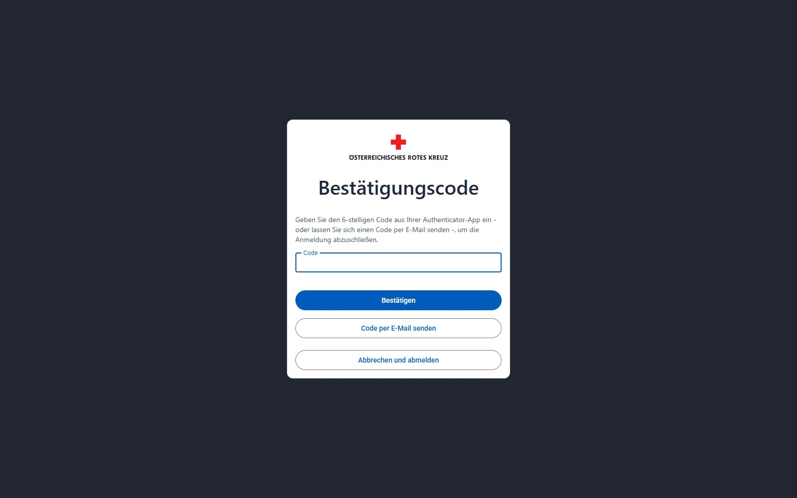

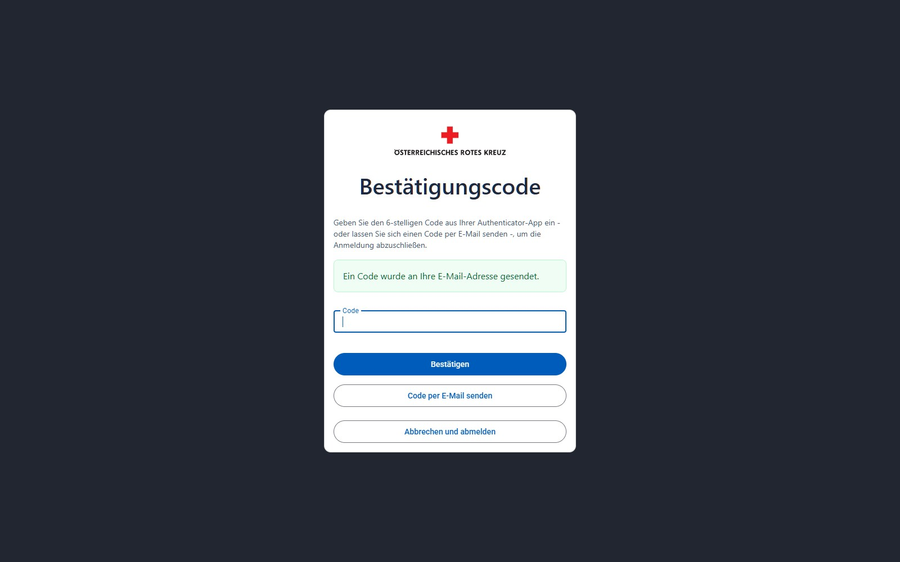

Ist für das Konto ein Passkey eingerichtet und kann der Browser Passkeys verwenden, steht auf der Seite zuoberst **Mit Passkey bestätigen**: Ein Klick darauf (oder die Eingabetaste, die Schaltfläche ist bereits ausgewählt) und die Bestätigung am Gerät schließen die Anmeldung ohne Code ab. Hat das Konto auch die Authenticator-App oder den Code per E-Mail, bleibt das Codefeld darunter stehen – für den Fall, dass das Gerät mit dem Passkey nicht zur Hand ist; ein Code per E-Mail wird dann nicht automatisch gesendet, sondern erst mit **Code per E-Mail senden**. Ist der Passkey die einzige Methode, heißt die Seite **Anmeldung bestätigen** und zeigt kein Codefeld; kann der Browser keinen Passkey verwenden, steht dort, dass man sich mit dem Gerät bzw. Browser des Passkeys anmelden oder einen Administrator um das Zurücksetzen bitten muss. Bricht man die Abfrage des Browsers ab, bleibt man auf der Seite und kann es erneut versuchen (oder, wenn vorhanden, den Code verwenden); ein abgelehnter Passkey zählt wie ein falscher Code als Fehlversuch.

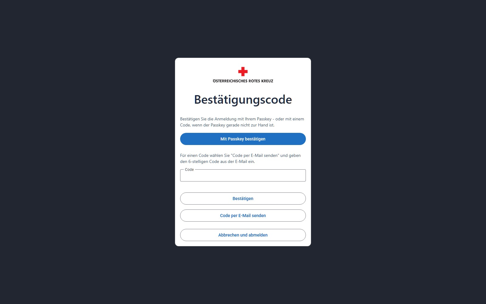

Je nach Grund wird am Login unterschiedlich informiert: bei falschem Benutzername/Passwort "Anmeldung fehlgeschlagen!" – dieselbe Meldung erscheint auch bei einem wegen zu vieler Fehlversuche vorübergehend gesperrten Konto, damit von außen nicht erkennbar ist, welche Konten gerade gesperrt sind (eine Administratorin/ein Administrator sieht den tatsächlichen Sperrstatus über Benutzer → Anmelde-Versuche) –, nach Ablauf der Sitzung während der Nutzung "Sitzung abgelaufen! Bitte erneut anmelden.", bei fehlender Berechtigung für eine aufgerufene Seite "Zugriff nicht erlaubt!", bei zu vielen Anmeldeversuchen von derselben Internetadresse in kurzer Zeit "Zu viele Anmeldeversuche! Bitte warten Sie einen Moment und versuchen Sie es erneut." und wenn der Server nicht erreichbar ist (z. B. bei einer Störung) "Server nicht erreichbar! Bitte überprüfen Sie Ihre Verbindung und versuchen Sie es erneut." – letzteres damit eine Störung nicht mit einem falschen Passwort verwechselt und unnötig ein Passwort zurückgesetzt wird. Bei jedem fehlgeschlagenen Anmeldeversuch springt der Cursor automatisch zurück ins Benutzername-Feld, dessen Inhalt markiert ist, sodass der nächste Versuch mit einem einzigen Tastendruck beginnen kann.

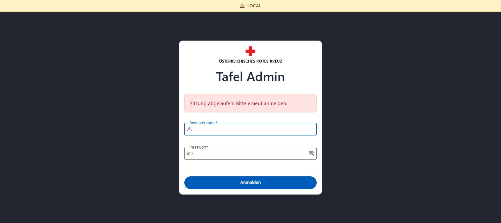

### Passwort vergessen?

Wer sein Passwort vergessen hat, wählt auf der Anmeldeseite **Passwort vergessen?** und gibt dort den Benutzernamen oder die E-Mail-Adresse des Kontos ein. Ist für das Konto eine E-Mail-Adresse hinterlegt (siehe [Benutzer](benutzer.md#benutzer-anlegen--bearbeiten) bzw. **Mein Konto** → **Meine Daten**), kommt an diese Adresse eine E-Mail mit dem Link **Neues Passwort festlegen**. Die Seite zeigt danach immer dieselbe Bestätigung, ob es ein solches Konto gibt oder nicht - so lässt sich von außen nicht herausfinden, welche Benutzernamen oder Adressen es gibt. Wer keine E-Mail bekommt (auch im Spam-Ordner nicht), hat entweder keine Adresse hinterlegt oder einen anderen Benutzernamen; dann setzt wie bisher eine Administratorin oder ein Administrator das Passwort zurück. Wird kurz hintereinander mehrmals ein Link angefordert, kommt innerhalb einer Minute nur eine E-Mail.

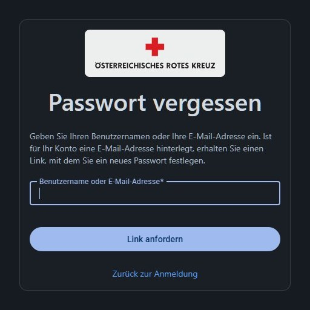

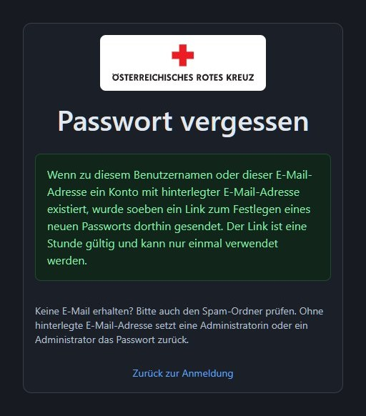

Der Link öffnet die Seite **Neues Passwort festlegen**. Dort gibt man das neue Passwort zweimal ein und bestätigt mit **Passwort speichern** - erst dieser Klick setzt das Passwort, das bloße Öffnen des Links ändert nichts. Es gelten dieselben Passwortregeln wie beim Ändern des Passworts (siehe oben). Danach sind alle bisherigen Anmeldungen des Kontos beendet, auch auf anderen Geräten, und man meldet sich mit dem neuen Passwort an; ist die Zwei-Faktor-Authentifizierung eingerichtet, wird dabei wie gewohnt nach dem Code gefragt. An die Adresse des Kontos geht zusätzlich ein Sicherheitshinweis, dass das Passwort neu gesetzt wurde.

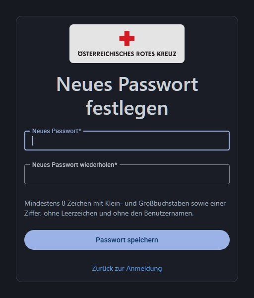

Ein Link ist eine Stunde gültig und kann nur einmal verwendet werden; ein neu angeforderter Link ersetzt den vorigen. Ein abgelaufener, bereits verwendeter oder ersetzter Link zeigt "Dieser Link ist ungültig oder abgelaufen." und über **Neuen Link anfordern** geht es zurück zur Seite **Passwort vergessen**.

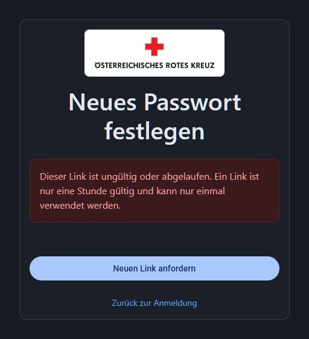

Der Link **Passwort vergessen?** erscheint nur, wenn der Betreiber den E-Mail-Versand eingerichtet und die Adresse der Anwendung hinterlegt hat.

## Navigation

Die linke Seitenleiste zeigt alle Menüpunkte, für die der angemeldete Benutzer berechtigt ist. Menüpunkte, die eine aktive Ausgabe voraussetzen (z. B. "Annahme", "Waren-Eingabe"), werden grau dargestellt und mit **INAKTIV** gekennzeichnet, solange kein Ausgabetag gestartet wurde; ein Kurzhinweis (Tooltip) "Keine Verteilung aktiv" erklärt den Grund, statt den Menüpunkt einfach verschwinden zu lassen. Untergeordnete Bereiche wie "Benutzer" und "Statistiken" lassen sich auf- und zuklappen. Über den Pfeil-Button unten in der Seitenleiste kann diese auf reine Icons eingeklappt werden, um mehr Platz für den Inhalt zu schaffen; auf schmalen Bildschirmen wird sie stattdessen über ein Menü-Symbol ein-/ausgeblendet (siehe [Darstellung auf schmalen Bildschirmen](#darstellung-auf-schmalen-bildschirmen)). Der eingeklappte Zustand der Seitenleiste sowie aufgeklappte Gruppen bleiben auch nach einem Neuladen der Seite erhalten.

Die Menüstruktur gliedert sich in folgende Bereiche:

- **Anmeldung**: Annahme, Scanner, Ticket-Monitor
- **Kunden**: Kunden suchen, Kunden anlegen, Anspruch-Schnellcheck, sowie unter der aufklappbaren Gruppe "Auswertungen": Neu & Verlängert, Duplikate, Über Limit, Gesperrt
- **Logistik**: Routen-Navi, Retourkisten, Waren-Eingabe
- **Verwaltung**: Benutzer, Statistiken, Zugriffsprotokoll, Datenauskunft, Einstellungen

"Einstellungen" ist ein einzelner Menüpunkt: Er öffnet eine Übersichtsseite, die alle Einstellungsbereiche als Karten nach Themen gruppiert zeigt – **Logistik** (Fahrzeuge, Filialen, Mitarbeiter, Routen, Waren-Kategorien, Retour-Kategorien), **Kunden & Betreuung** (Grenzwerte, Länder, Notschlafstellen) und **System** (Ankündigungen, Anstehende Löschungen, E-Mail). Ein Klick auf eine Karte öffnet den jeweiligen Bereich; Bereiche ohne Berechtigung werden nicht angezeigt. Solange eine Seite der Einstellungen geöffnet ist, listet die Seitenleiste statt des Hauptmenüs die Übersicht und alle Bereiche der Einstellungen nach denselben Themen, mit **Zurück zur Anwendung** ganz oben – so wie bei **Mein Konto** (siehe [Einstellungen](einstellungen.md)). Über die Schnellsuche (Strg+K) lässt sich jeder Bereich weiterhin direkt aufrufen.

Welche Menüpunkte sichtbar sind, hängt von den dem Benutzer zugewiesenen Berechtigungen ab (siehe [Benutzer](benutzer.md)).

Ist die Seitenleiste eingeklappt, sind nur noch die Icons sichtbar. Fährt man mit der Maus über ein Icon, wird der Name des Menüpunkts als Kurzhinweis (Tooltip) eingeblendet.

### Schnellsuche (Strg+K)

Mit der Tastenkombination **Strg+K** (bzw. **Cmd+K** auf macOS) – oder über das Lupen-Symbol oben links in der Kopfzeile – öffnet sich von jeder Seite aus die **Schnellsuche**. Während der Eingabe werden bis zu drei Arten von Treffern angezeigt:

- **Navigation**: alle Menüpunkte, deren Name den Suchbegriff enthält. Ein Klick wechselt direkt auf die jeweilige Seite.
- **Aktionen**: die **Datenschutzerklärung (Vorlage) herunterladen** – dieselbe Vorlage ohne Kundenbezug wie bei der [Kunden-Suche](kunden.md#kunden-suchen) – sowie die **Datenschutzerklärung (Mitarbeiter) herunterladen** – dieselbe wie unter **Datenschutz** von **Mein Konto** (siehe oben) –, beide von jeder Seite aus erreichbar. Ein Klick lädt die jeweilige Datei direkt herunter, ohne die aktuelle Seite zu verlassen.
- **Kunden**: ab zwei Zeichen wird zusätzlich in den Kunden gesucht – nach Kundennummer, Namen (auch der weiteren Personen im Haushalt), Adresse, Telefonnummer oder E-Mail, mit derselben Fehlertoleranz wie die Kunden-Suche (siehe [Kunden](kunden.md)). Ein Klick öffnet direkt die Detailseite des Kunden.

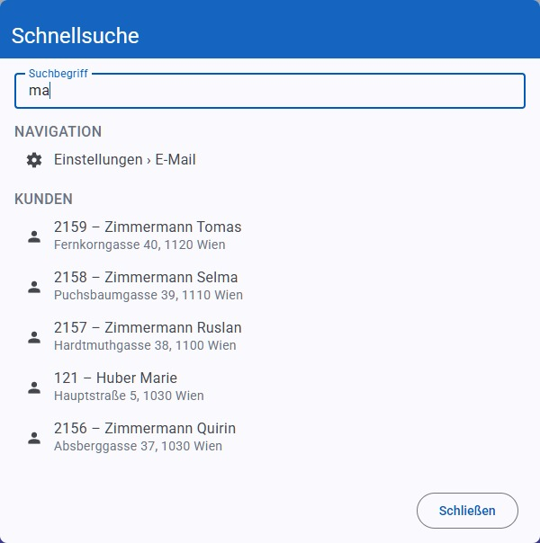

Angezeigt werden nur Menüpunkte, Aktionen und Kunden, für die der angemeldete Benutzer berechtigt ist; Menüpunkte, die eine aktive Ausgabe voraussetzen, erscheinen nur während eines Ausgabetags. Mit den **Pfeiltasten** wird durch die Treffer navigiert, **Enter** öffnet den ersten Treffer direkt aus dem Suchfeld - immer den ersten Treffer zur gerade eingetippten Eingabe, auch wenn sofort nach dem Tippen Enter gedrückt wird (sucht die Anwendung die Kunden dazu noch, öffnet Enter einen Kunden erst, wenn die Treffer zur Eingabe da sind), **Esc** schließt die Schnellsuche wieder.

Links in der Kopfzeile wird neben den Schaltflächen immer der Name der gerade geöffneten Seite angezeigt. Oben rechts zeigt ein Badge **Live-Verbindung**, ob die Anwendung aktuell aktiv mit dem Server verbunden ist (z. B. relevant für Live-Updates wie den Ticket-Monitor); ist die Verbindung unterbrochen, wechselt der Status entsprechend. Direkt daneben zeigt ein weiteres Badge dauerhaft den Status des Ausgabetags ("Ausgabe geöffnet" bzw. "Ausgabe geschlossen"), bei einer geöffneten Ausgabe zusätzlich mit ihrer Startzeit – nicht nur auf der Übersicht (siehe [Übersicht (Dashboard)](#übersicht-dashboard)), sondern auf jeder Seite der Anwendung. Links neben diesem Badge steht die aktuelle Uhrzeit (Wiener Zeit), sodass sie auch auf einem zweiten Bildschirm ohne Systemuhr sichtbar bleibt; auf Smartphones entfällt sie, dort zeigt das Gerät selbst die Uhrzeit. Solange eine Ausgabe geöffnet ist, zeigt ein weiteres Badge **„x Kunden angemeldet“** die aktuelle Zahl der angemeldeten Kunden – dieselbe Zahl wie auf der Übersicht, aber auch während der Annahme sichtbar und live aktualisiert. Damit lässt sich Kund:innen, die eine hohe Ticketnummer beanstanden, zeigen, wie viele Kunden tatsächlich angemeldet sind. Das Badge erscheint ab einer Bildschirmbreite von etwa 1280 Pixeln; auf schmaleren Bildschirmen bleibt die Zahl auf der Übersicht. Vorleseprogramme lesen die Zahl nicht bei jeder neuen Anmeldung vor. Unten in der Seitenleiste werden zudem die aktuelle Version und das Build-Datum der Anwendung angezeigt.

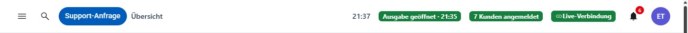

### Benachrichtigungen (Glocke)

Die **Glocke** in der Kopfzeile (links neben dem Benutzermenü) sammelt alles, was für einen selbst bestimmt ist. Ein roter Zähler nennt die Anzahl der ungelesenen Einträge. Ein Klick öffnet die Liste, neueste zuerst:

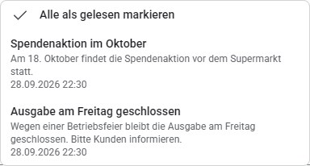

- **Benachrichtigungen**, die auch als Push-Nachricht verschickt werden (siehe [Benachrichtigungen](#benachrichtigungen)). Sie stehen in der Glocke auch dann, wenn Push auf dem Gerät nicht eingeschaltet ist - wer die Nachricht verpasst hat, findet sie beim nächsten Login hier. Jeder sieht nur die Benachrichtigungen, die für seine Berechtigungen bestimmt sind.
- **Ankündigungen**, die Administratoren für alle Benutzer veröffentlichen (siehe [Ankündigungen](einstellungen.md#ankuendigungen)).

Die Liste zeigt die zehn neuesten Einträge; **Alle anzeigen** klappt die weiteren (bis zu 50) in derselben Liste auf. Ungelesene Einträge sind fett dargestellt. Ein Klick auf einen Eintrag markiert ihn als gelesen und öffnet - falls vorhanden - die zugehörige Seite, etwa die Übersicht. **Alle als gelesen markieren** setzt alle Einträge auf einmal auf gelesen. Die Glocke aktualisiert sich von selbst, sobald etwas Neues eintrifft, und beim Öffnen; Einträge werden nach 30 Tagen (einstellbar durch die Betreiberin bzw. den Betreiber) automatisch entfernt.

## Bedienung mit der Tastatur

Die Anwendung lässt sich vollständig ohne Maus bedienen. Mit der **Tabulator-Taste** wird von Bedienelement zu Bedienelement gesprungen, mit **Enter** bzw. **Leertaste** wird das gerade angesprungene Element ausgelöst.

- Der erste Tabulator-Schritt auf jeder Seite ist der Sprunglink **"Zum Hauptinhalt springen"**. Er ist nur sichtbar, solange er angesprungen ist, und überspringt die gesamte Seitenleiste – ohne ihn müsste man sich auf jeder Seite erneut durch das komplette Menü tabben.
- Die aufklappbaren Menügruppen ("Auswertungen", "Benutzer", "Statistiken") lassen sich ebenso mit der Tastatur auf- und zuklappen.
- Menüpunkte, die eine aktive Ausgabe voraussetzen und mit **INAKTIV** gekennzeichnet sind, werden beim Tabben übersprungen.
- Das Augen-Symbol in Passwortfeldern, mit dem das eingegebene Passwort sichtbar gemacht wird, ist ebenfalls per Tastatur erreichbar.
- Die [Schnellsuche](#schnellsuche) öffnet sich von jeder Seite aus mit **Strg+K** (bzw. **Cmd+K** auf macOS) und wird vollständig mit Suchfeld, Pfeiltasten und Enter bedient.
- Sortierbare Listen in den [Einstellungen](einstellungen.md) werden nicht nur per Drag & Drop sortiert: Ist das Drag-Handle (⋮⋮) angesprungen, verschieben die Pfeiltasten den Eintrag um je eine Position, und die neue Position wird für Vorleseprogramme angesagt.

Der Titel im Browser-Tab nennt immer die gerade geöffnete Seite (z. B. "Kunden suchen – Tafel Admin"). Dadurch sind auch mehrere geöffnete Tabs und Einträge im Browser-Verlauf auseinanderzuhalten, und Vorleseprogramme geben beim Seitenwechsel den Namen der neuen Seite aus. Ebenso wird der Zustand der **Live-Verbindung** aus der Kopfzeile nicht nur farblich, sondern auch als Text ausgegeben, sodass ein Verbindungsabbruch auch mit einem Vorleseprogramm bemerkt wird.

## Darstellung auf schmalen Bildschirmen

Die Anwendung wird auch auf Handy und Tablet verwendet – etwa als Scanner bei der Kunden-Annahme (siehe [Anmeldung](anmeldung.md)) oder für Routen-Navi und Warenerfassung unterwegs im Fahrzeug (siehe [Logistik](logistik.md)). Dafür gibt es keine eigene App und keine eigene Adresse: Es ist dieselbe Anwendung im Browser, die sich lediglich automatisch an die verfügbare Bildschirmbreite anpasst. Wird am PC das Browserfenster schmal gezogen, passiert dasselbe.

Umgestellt wird in zwei Stufen:

- **Unter rund 1.000 Pixel Breite** (Tablets, schmale Fenster) wird die Seitenleiste ausgeblendet und stattdessen über das Menü-Symbol (☰) links oben als Überblendung geöffnet. Sie schließt sich wieder, sobald ein Menüpunkt gewählt oder daneben getippt wird. Die Schaltfläche zum Einklappen auf reine Icons entfällt in dieser Ansicht. Der Name der aktuellen Seite bleibt dabei über die Kopfzeile sichtbar, auch wenn das Menü geschlossen ist.
- **Unter rund 770 Pixel Breite** (Handys) werden zusätzlich alle Tabellen als **Kartenliste** dargestellt: eine Karte je Eintrag, in der die Tabellenspalten als Beschriftung und Wert untereinander stehen. Formulare werden einspaltig untereinander angeordnet statt in mehreren Spalten nebeneinander.

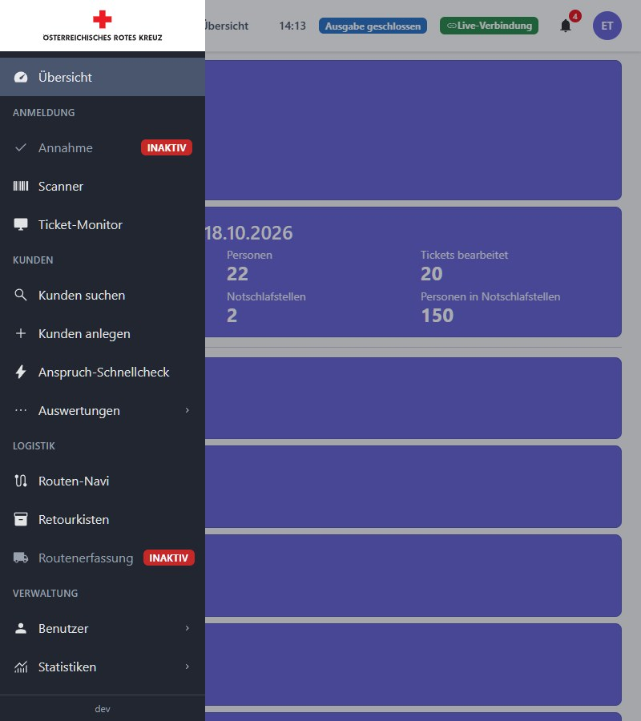

Inhaltlich ändert sich dadurch nichts: Es sind dieselben Daten, dieselben Aktionen (Lupe, Stift, Papierkorb usw.), dieselbe Seitennavigation und dieselben Berechtigungen wie in der Tabellenansicht. Als Kartenliste dargestellt werden das Suchergebnis der Kunden-Suche, die Listen "Kunden über Limit" und "Kunden-Übersicht" (siehe [Kunden](kunden.md)), das Suchergebnis der Benutzer-Suche und die Anmelde-Versuche (siehe [Benutzer](benutzer.md)), die Tabellen der [Einstellungen](einstellungen.md) sowie die Ergebnisliste der Auswertung Kinder (siehe [Statistiken](statistiken.md)). Filialen und Routen sind keine Tabellen, sondern aufklappbare Listen, und sehen daher auf jeder Bildschirmbreite gleich aus.

Eine Ausnahme ist die Warenerfassung: Sie wird auf schmalen Bildschirmen nicht als Kartenliste, sondern als eigener Ablauf Geschäft für Geschäft dargestellt (siehe [Logistik](logistik.md)).

## Kurzhinweise (Tooltips)

An zwei Stellen blendet die Anwendung zusätzliche Erklärungen ein, ohne dass die Oberfläche dadurch voller wird.

**Schaltflächen mit reinem Symbol** (Lupe, Stift, Mistkübel, Auge, Plus, Haken usw.) zeigen ihre Funktion als Kurzhinweis an, sobald man mit der Maus darauf stehen bleibt. Damit muss die Bedeutung eines Symbols nicht auswendig gewusst werden – im Beispiel der Stift im Suchergebnis der Kunden-Suche:

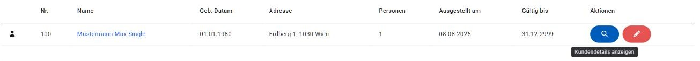

**Felder mit fachlicher Bedeutung** haben ein kleines Info-Symbol (ⓘ) neben der Beschriftung. Der Kurzhinweis dahinter erklärt, was das Feld bewirkt – etwa wie das eingetragene Einkommen in die Anspruchsprüfung einfließt oder dass "Alleinerzieher" ausschließlich in die Statistik einfließt und die Einkommensgrenze nicht verändert:

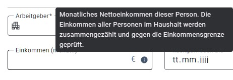

Auf Touch-Geräten erscheinen die Kurzhinweise, wenn man das Symbol kurz gedrückt hält. Mit der Tastatur werden sie eingeblendet, sobald die jeweilige Schaltfläche den Fokus erhält.

## Datum und Uhrzeit eingeben

Ein Datum wird überall in der Anwendung als **TT.MM.JJJJ** angezeigt und eingegeben (z. B. `24.12.2026`), eine Uhrzeit im **24-Stunden-Format** als `HH:MM` (z. B. `14:30`) – unabhängig davon, in welcher Sprache der Browser oder das Gerät eingestellt ist.

Ein Datum kann **getippt** oder aus dem **Kalender** gewählt werden:

- Beim Tippen werden mehrere Schreibweisen verstanden: mit Punkten (`24.12.2026`, `1.2.2026`), nur die Ziffern (`24122026`) und mit zweistelligem Jahr (`1.2.26`). Sobald das Feld verlassen wird, steht das Datum ausgeschrieben als `01.02.2026` darin.
- Ein zweistelliges Jahr wird als das naheliegende gelesen: `26` als 2026, `85` als 1985. Jahre, die mehr als zehn Jahre in der Zukunft lägen, gelten als Jahre des vorigen Jahrhunderts – bei weit zurückliegenden Geburtsjahren daher besser das Jahr vierstellig schreiben.
- Das **Kalender-Symbol** rechts im Feld öffnet einen Kalender, in dem der Tag angeklickt wird. Ein Klick auf Monat und Jahr oben links wechselt zur Auswahl von Jahr und Monat; bei Geburtsdaten beginnt der Kalender gleich mit der Jahresauswahl.
- Steht im Feld etwas, das kein Datum ist (z. B. `31.02.2026`), meldet das Feld **"Ungültiges Datum (TT.MM.JJJJ)"**, und das Formular lässt sich so nicht speichern.

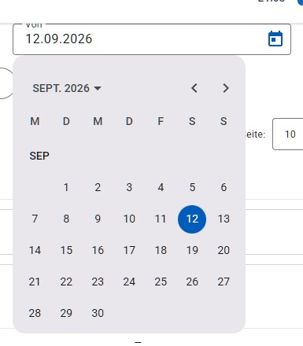

Eine Uhrzeit wird ebenso getippt – mit Doppelpunkt (`14:30`), nur als Ziffern (`1430`, `930`) oder als volle Stunde (`14`). Das **Uhr-Symbol** rechts im Feld öffnet eine Liste mit Uhrzeiten im Halbstundentakt zur Auswahl.

## Übersicht (Dashboard)

Die Übersicht ist die Startseite und zeigt den aktuellen Status des Ausgabetags sowie Kennzahlen des Tages. **Status** ist dabei immer sichtbar. Solange keine Ausgabe läuft, zeigt die Übersicht anstelle der tagesbezogenen Kennzahlen eine kurze Zusammenfassung der zuletzt abgeschlossenen Ausgabe (Kunden, Personen, bearbeitete Tickets, erfasste Warenmenge sowie Anzahl der genutzten Notschlafstellen und der Personen darin) – wurde noch nie eine Ausgabe abgeschlossen, erscheint stattdessen ein Hinweistext:

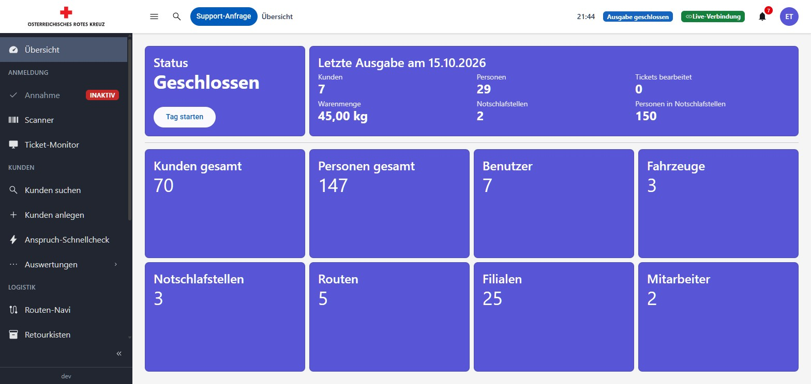

- **Status**: Zeigt an, ob der Ausgabetag "Geöffnet" oder "Geschlossen" ist. Mit **Tag starten** wird eine neue Ausgabe begonnen, mit **Tag beenden** wird sie abgeschlossen (dabei werden u. a. die Mitarbeiterzahl und die genutzten Notschlafstellen abgefragt).

Darunter zeigt die Übersicht, solange keine Ausgabe läuft, zusätzlich organisationsweite Kennzahlen – wie viele Kunden und Personen insgesamt aktuell gültig (und nicht gesperrt) sind, sowie die Anzahl der aktiven Benutzer, Fahrzeuge, Notschlafstellen, Routen und Filialen sowie die Mitarbeiteranzahl. Jede dieser Kacheln ist an dieselbe Berechtigung geknüpft wie der jeweilige Verwaltungsbereich (**Kunden gesamt**/**Personen gesamt** an die Kundenverwaltung, **Benutzer** an die Benutzerverwaltung, **Mitarbeiter** an die Einstellungen-Berechtigung, die übrigen an die Transport/Logistik-Berechtigung) und erscheint nur, wenn diese vorhanden ist.

Sobald eine Ausgabe läuft, zeigt die Übersicht stattdessen die folgenden tagesbezogenen Kennzahlen:

- **Kunden angemeldet**: Anzahl der für den heutigen Tag angemeldeten Kunden. Über **Kundenliste** kann die Liste der angemeldeten Kunden heruntergeladen werden.
- **Personen angemeldet**: Anzahl aller Personen, für die die angemeldeten Kunden Waren erhalten — die Hauptperson jedes Haushalts plus die weiteren Personen im Haushalt. Als "Nicht im selben Haushalt" markierte Personen zählen nicht mit.
- **Tickets abgearbeitet**: Fortschritt der Ticket-Bearbeitung (verarbeitete / gesamt) als Zahl und als Balken darunter.
- **Erfasste Routen**: Fortschritt der Warenerfassung aus der Logistik (siehe [Logistik](logistik.md)) – als Zahl mit Balken sowie daneben alle heute zu fahrenden Routen als kleine Kacheln (Chips). Bereits vollständig erfasste Routen sind grün mit Häkchen markiert, die übrigen sind neutral. So ist auf einen Blick erkennbar, welche Routen noch fehlen, statt die erfassten gegen die Gesamtzahl abzuzählen.
- **Erfasste Warenmenge**: Gesamtgewicht der bisher erfassten Warenmengen.
- **Routen unterwegs**: Zeigt je Route, wie viele Stopps die Fahrer heute bereits abgehakt haben (z. B. "2 / 7"). Der Balken daneben besteht aus einem Abschnitt je Stopp, die erledigten sind grün — so ist auf einen Blick erkennbar, wie viele Stopps eine Route überhaupt hat und wie viele davon schon hinter ihr liegen. Grundlage ist das [Routen-Navi](logistik.md#routen-navi); die Anzeige aktualisiert sich automatisch, sobald unterwegs ein Stopp abgehakt wird — so ist in der Zentrale ohne Anruf ersichtlich, wo eine Route gerade steht. Der Bereich erscheint erst, sobald an diesem Tag der erste Stopp abgehakt wurde: Wird das Routen-Navi nicht verwendet, bleibt er ganz aus. Ab dann werden alle Routen angeführt, auch die noch bei "0 / 15" stehenden; Routen ohne hinterlegte Stopps werden nicht angeführt.
- **Statistik**: Eingabe der Mitarbeiteranzahl und der Personen in den ausgewählten Notschlafstellen für den Tagesreport. Die Anzahl der Personen in Notschlafstellen wird über den Rechner-Button neben dem Feld ermittelt, indem die genutzten Notschlafstellen ausgewählt werden.
- **Anmerkungen**: Freitext-Notizen zum aktuellen Ausgabetag, die z. B. im Tagesreport per E-Mail versendet werden.

Vor dem Beenden des Ausgabetags sollten Statistik und Anmerkungen vollständig ausgefüllt sein, da diese Angaben in den Tagesreport einfließen:

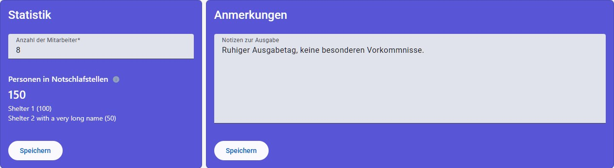

## Support-Anfrage

Über die Schaltfläche **Support-Anfrage** oben in der Kopfzeile kann jederzeit ein Anliegen (Fehler, Verbesserungsvorschlag) mit Titel und Beschreibung gemeldet werden. Die Anfrage wird per E-Mail versandt.

Damit ein Fehler nachvollzogen werden kann, werden automatisch technische Infos mitgeschickt: Benutzername, Zeitpunkt, aktuelle Seite, Version, Browser sowie die letzten Fehlermeldungen dieser Sitzung. Diese Angaben müssen nicht selbst eingetippt werden – im Text genügt eine Beschreibung dessen, was passiert ist.

Zusätzlich wird immer ein **Screenshot der Seite** angehängt, die beim Öffnen der Support-Anfrage zu sehen war (das Dialogfenster selbst ist darauf nicht zu sehen). Der Dialog weist darauf hin, was alles mitgeschickt wird.

> [!TIP]
> Sind auf dem Bildschirm gerade Kundendaten zu sehen, die nicht mitgeschickt werden sollen: zuerst die Seite verlassen (z. B. zurück auf die Übersicht) und die Support-Anfrage erst dort öffnen.

> [!IMPORTANT]
> Auch wenn die Anfrage nur intern per E-Mail verschickt wird: Titel und Beschreibung sollten keine personenbezogenen Daten enthalten – also keine Namen, Adressen, Geburtsdaten oder Einkommensangaben von Kundinnen und Kunden. Statt „Kunde Max Mustermann kann sich nicht anmelden“ besser die Kundennummer oder nur den Ablauf beschreiben.

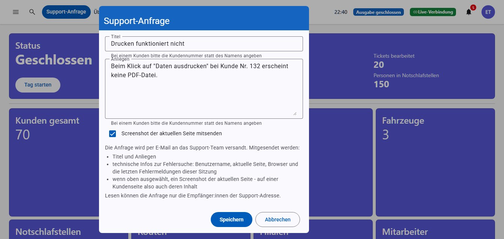

## Fehlerseiten

Ist eine aufgerufene Seite nicht vorhanden, zeigt die Anwendung eine 404-Fehlerseite mit den Schaltflächen **Zur Übersicht** und **Zurück**, um ohne Umweg über die Adressleiste weiterzuarbeiten:

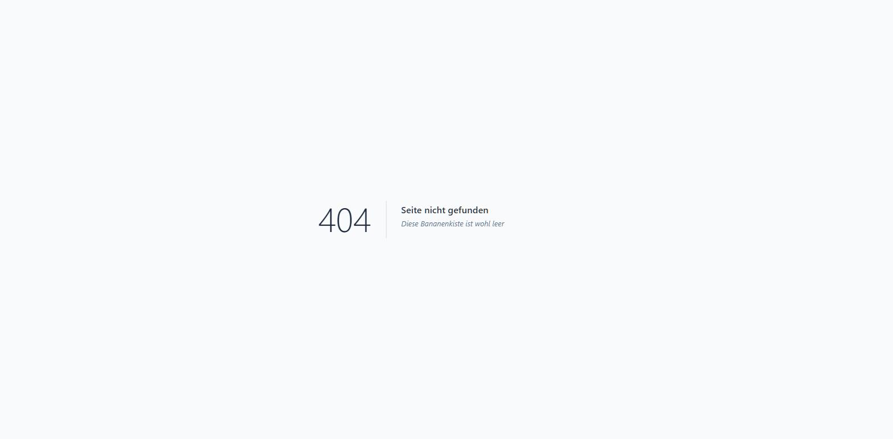

Tritt bei einer Anfrage ein unerwarteter Serverfehler auf, zeigt die Anwendung eine 500-Fehlerseite. Neben **Zur Übersicht** und **Zurück** steht hier zusätzlich **Neu laden** zur Verfügung; tritt der Fehler weiterhin auf, kann er über **Support-Anfrage** oben in der Kopfzeile gemeldet werden (siehe oben).

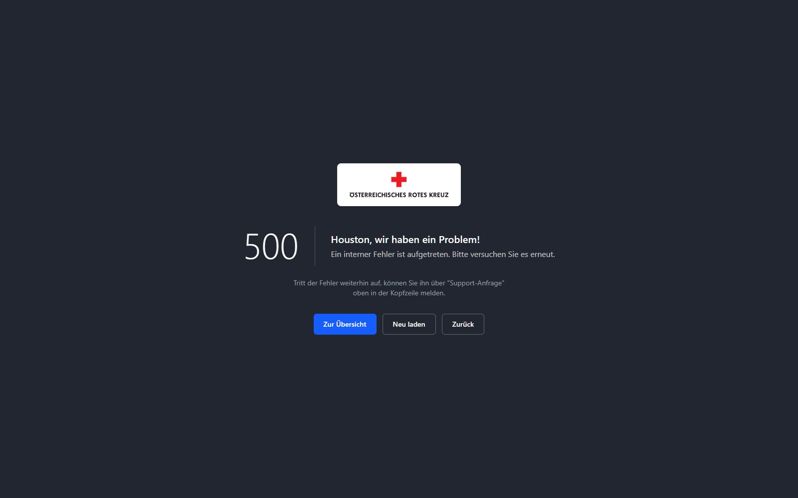

Diese beiden Fehlerseiten erscheinen nur, wenn die Anwendung direkt über einen Link, ein Lesezeichen oder ein Neuladen der Seite geöffnet wurde. Schlägt dagegen ein Seitenwechsel innerhalb der bereits geöffneten Anwendung fehl – etwa weil der Server für einen Moment nicht erreichbar ist –, bleibt die aktuelle Seite geöffnet und es erscheint nur eine Meldung. Der Menüpunkt kann dann einfach nochmal angeklickt werden. Konnte ein Teil der Anwendung nicht nachgeladen werden – typischerweise, weil der Tab über das Einspielen einer neuen Version hinweg offen geblieben ist –, lädt die Anwendung die gewünschte Seite einmal von selbst neu. Erscheint danach trotzdem eine Meldung, die ein Neuladen der Anwendung verlangt, die Seite im Browser neu laden (F5).
